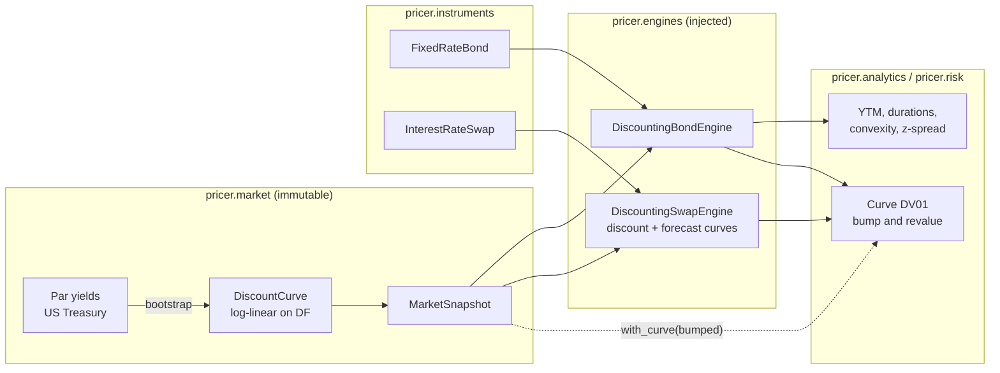

# Pricing & Risk Engine

[](https://github.com/Djewiet/pricing-risk-engine/actions/workflows/ci.yml)
[](https://djewiet.github.io/pricing-risk-engine/)


[](LICENSE)

A production-grade Python pricing and risk library, with a distributed, real-time risk
service built on top of it.

> **Status: phase 1 (foundations).** Dates and day counts, immutable market snapshot,
> yield-curve bootstrap from US Treasury par yields, fixed-rate bonds (pricing, yield,
> durations, convexity, z-spread, curve DV01) and vanilla interest rate swaps on separate
> forecast and discount curves. Every formula is validated against QuantLib.

**Documentation:** <https://djewiet.github.io/pricing-risk-engine/>, with a
[reading guide](docs/reading-guide.md) (which files to read, in which order, and why), the
[architecture](docs/architecture/index.md), and the finance behind each model
([curve](docs/finance/yield-curve.md), [bond](docs/finance/fixed-rate-bond.md),
[analytics](docs/finance/bond-analytics.md), [swap](docs/finance/interest-rate-swap.md)).

## Quickstart

```bash
git clone https://github.com/Djewiet/pricing-risk-engine.git && cd pricing-risk-engine
uv sync
uv run python examples/price_bond.py
```

```text
Curve: 11 pillars, max repricing error 8.7e-16
Bond 4.25% Aug-2035: clean 100.8052, accrued 1.5938, dirty 102.3989
YTM 4.1472%, modified duration 7.7232, convexity 71.74, yield DV01 0.0791
Curve DV01 0.0805, z-spread at 1 point below the curve price 0.12%
```

Checks, as run in CI:

```bash
uv run pytest --cov                          # unit tests, coverage gate at 90%
uv run pytest validation                     # QuantLib benchmark suite
uv run mypy                                  # mypy --strict
uv run ruff check . && uv run ruff format --check .
uv run --group docs mkdocs serve             # documentation site, locally
```

## Usage

```python
from datetime import UTC, date, datetime

from pricer.analytics import yield_analytics, yield_to_maturity
from pricer.dates import Tenor
from pricer.engines import DiscountingBondEngine, DiscountingSwapEngine
from pricer.instruments import FixedRateBond, InterestRateSwap
from pricer.market import MarketSnapshot, ParYieldQuote, bootstrap_par_yield_curve
from pricer.risk import parallel_dv01

as_of = date(2025, 12, 31)
quotes = [
    ParYieldQuote(Tenor.parse(t), r)
    for t, r in {"1Y": 0.0347, "2Y": 0.0347, "5Y": 0.0373, "10Y": 0.0417, "30Y": 0.0484}.items()
]
snapshot = MarketSnapshot(
    timestamp=datetime(2025, 12, 31, 21, 0, tzinfo=UTC),
    valuation_date=as_of,
    curves={"USD-TSY": bootstrap_par_yield_curve(as_of, quotes)},
)

# Bond: the instrument holds the contract, the engine prices it on the snapshot.
bond = FixedRateBond(issue_date=date(2025, 8, 15), maturity=date(2035, 8, 15), coupon_rate=0.0425)
bond_engine = DiscountingBondEngine(curve_name="USD-TSY")
valuation = bond_engine.price(bond, snapshot)  # clean, dirty, accrued
ytm = yield_to_maturity(bond, valuation.clean_price, as_of)
risk = yield_analytics(bond, ytm, as_of)  # durations, convexity, yield DV01

# Swap: two curve roles, the same curve in phase 1.
swap = InterestRateSwap(effective_date=as_of, maturity=date(2035, 12, 31), fixed_rate=0.04)
swap_engine = DiscountingSwapEngine(discount_curve="USD-TSY", forecast_curve="USD-TSY")
par_rate = swap_engine.price(swap, snapshot).par_rate

# Risk is written against the snapshot, so it works for any instrument.
bond_dv01 = parallel_dv01(lambda m: bond_engine.price(bond, m).npv, snapshot, "USD-TSY")
swap_dv01 = parallel_dv01(lambda m: swap_engine.price(swap, m).npv, snapshot, "USD-TSY")
```

Live data: `pricer.market.sources.us_treasury.fetch_par_yields(2025)` downloads the US
Treasury *Daily Par Yield Curve Rates* (public, no API key).

## Architecture



- **Instrument / Model / Engine separation.** Instruments hold contract terms and
  contractual cash flows, models hold dynamics, engines compute. Engines are injected
  (Strategy pattern): a new method is a new class, never an `isinstance` branch.
- **One immutable market input.** Every pricing call takes a `MarketSnapshot`. A price is a
  pure function of (instrument, engine, snapshot): reproducible, safe to share across
  processes, and bumped scenarios never corrupt the base one.
- **Explicit conventions.** Day counts, schedules, compounding and the curve time axis are
  always explicit; nothing is rolled or adjusted silently.
- **Independent validation.** Closed forms, arbitrage properties (hypothesis) and a QuantLib
  benchmark with identical conventions: 60 cases, discount factors to 1e-11, bond prices
  to 1e-10, swap NPVs to 1e-8 of notional.

More diagrams (module layers, class model, pricing sequences) in
[docs/architecture](docs/architecture/index.md).

## Layout

```
src/pricer/
  dates/        tenors, schedules, day-count conventions
  market/       yield curves, bootstrap, volatility, MarketSnapshot
    sources/    public market-data loaders (US Treasury)
  instruments/  contract terms and cash flows (FixedRateBond, InterestRateSwap)
  engines/      pricing engines, injected per instrument
  analytics/    yield-based measures: YTM, durations, convexity, z-spread
  risk/         bump-and-revalue risk (parallel curve DV01)
tests/          unit tests mirroring src/ (pytest, hypothesis)
validation/     model validation against QuantLib
examples/       runnable end-to-end scripts (executed by the tests)
docs/           MkDocs site: reading guide, architecture, finance notes, ADRs
```

## Roadmap

1. **Foundations**: curve, bonds, swaps (done); calendars, key-rate DV01.
2. **Options**: Black-Scholes, CRR tree, Monte Carlo, Greeks, validation report.
3. **Heston and performance**: NumPy → Numba → multi-process, benchmarked.
4. **Risk service**: Redis Streams, worker pool, FastAPI + WebSocket, VaR, PostgreSQL.
5. **Polish**: Prometheus/Grafana, published validation report.

Details in [docs/roadmap.md](docs/roadmap.md). Design decisions are recorded as
[ADRs](docs/adr/).

## License

MIT
