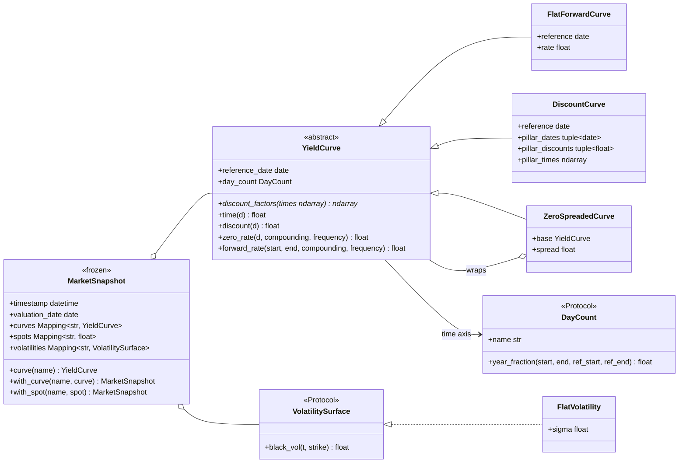
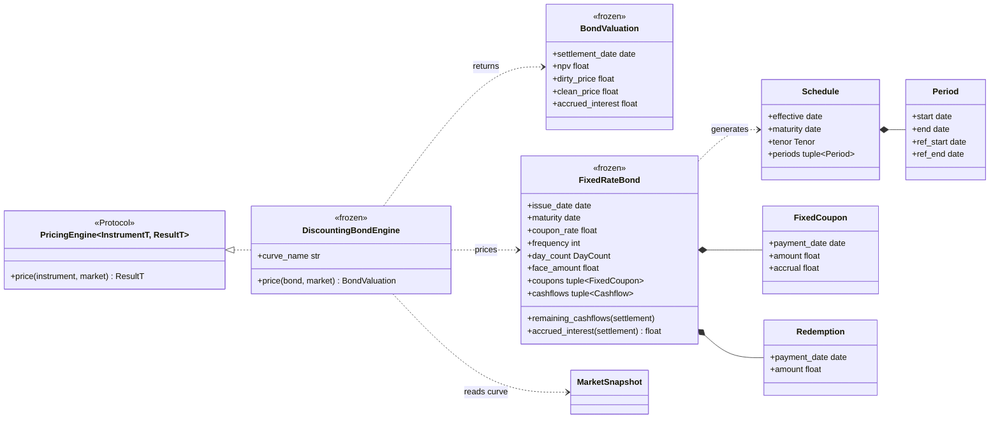
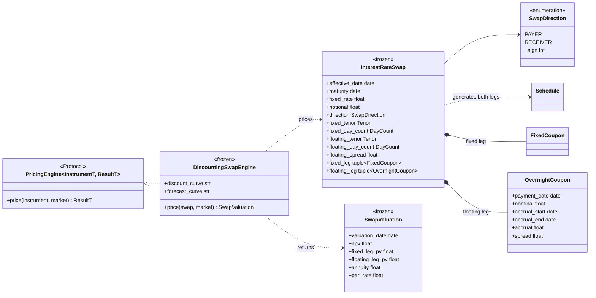

# Class model

## Core types

## Reading the diagrams

- **`YieldCurve` is a Template Method.** Subclasses implement one vectorised primitive,
  `discount_factors`; zero rates, forwards and date-based lookups are derived once in the
  base class. A new curve type (monotone-convex, Nelson-Siegel) is one method.
- **`ZeroSpreadedCurve` is a Decorator.** It wraps any curve and multiplies its discount
  factors by \(e^{-st}\). The parallel bump of the DV01 and the z-spread both use it, and the
  shift is exact at every \(t\), whatever the base interpolation.
- **Protocols, not base classes, at the edges.** `DayCount`, `VolatilitySurface` and
  `PricingEngine` are structural types: any object with the right method qualifies, with no
  inheritance coupling.
- **Frozen dataclasses everywhere.** Instruments, snapshots, results and engines are
  immutable; `DiscountCurve` also freezes its NumPy arrays (`setflags(write=False)`).
- **`PricingEngine` is generic in its result.** A bond engine returns `BondValuation`, an
  option engine will return a price with Greeks: one protocol, typed per engine.

## Swap

None of the existing classes changed to add the swap: it reuses `Schedule`, `DayCount`,
`FixedCoupon`, `YieldCurve` and `MarketSnapshot`, and `parallel_dv01` applies to it
unchanged. The engine takes two curve names instead of one: the curve *roles* are part of
the engine, not of the instrument.
