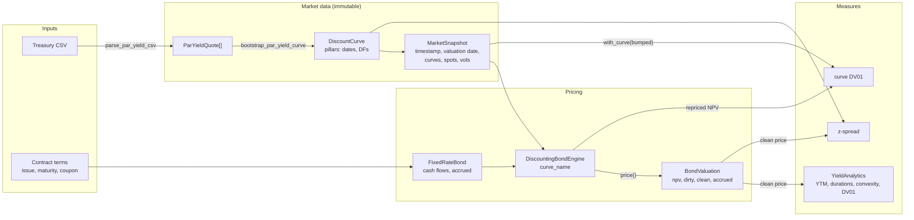
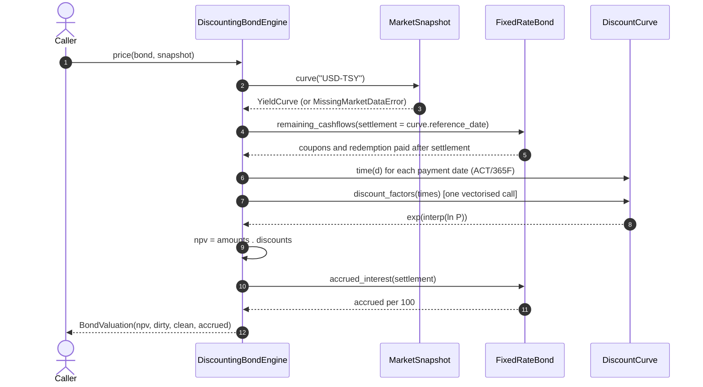
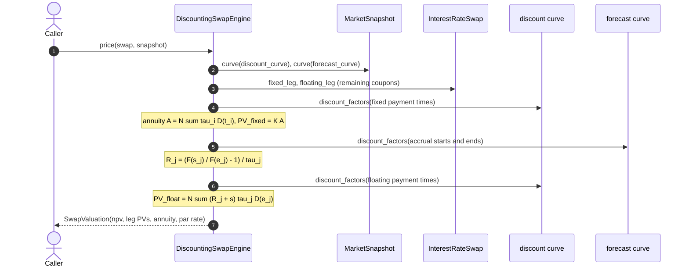
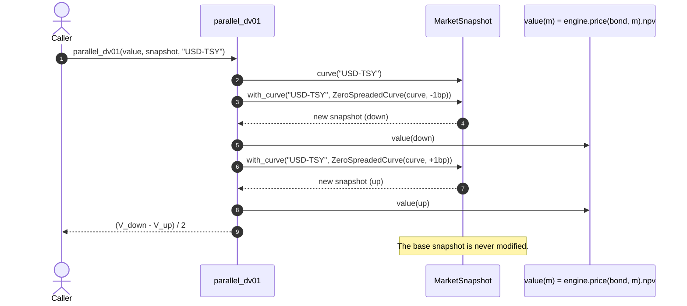
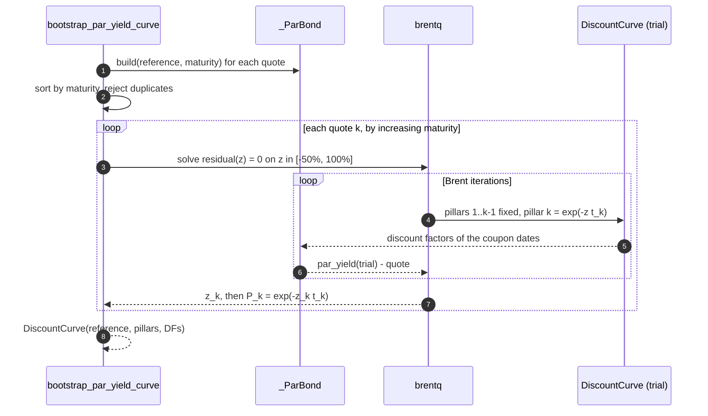

# Data flow

## From quotes to risk numbers

Three properties of this flow matter:

1. **The snapshot is the only market input.** The engine receives the snapshot and looks
   up the curve by name (`curve_name="USD-TSY"`). Nothing reads market data from a global.
2. **Analytics work from a price, not from a market.** `yield_to_maturity` and
   `yield_analytics` take a bond, a price or yield, and a settlement date. They do not need
   a snapshot, which is why they live in `analytics/` and not in `engines/`.
3. **Risk is a higher-order function.** `parallel_dv01` takes a `MarketSnapshot -> float`
   function. It does not know about bonds: the same function will compute the DV01 of a
   swap or of a whole portfolio.

## Sequence of one pricing call

Settlement is the curve reference date, which the snapshot guarantees is the valuation
date (T+0). A cash flow paid *on* the settlement date is excluded: it belongs to the seller.

## Sequence of a swap pricing

The swap engine follows the same pattern with two curve roles. In phase 1 both names point
to the same Treasury curve.

## Sequence of a curve DV01

## Sequence of the bootstrap

