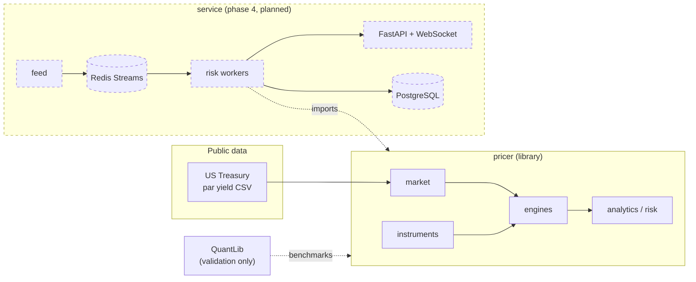
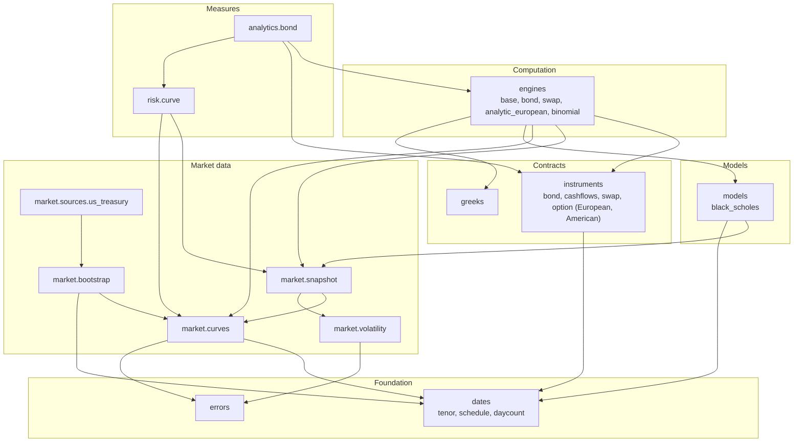

# Architecture overview

The project has two parts, specified in `SPEC.md`:

- **`pricer`**, a quant library: market data, instruments, models, engines, risk. It has no
  I/O apart from the public market-data loaders, and no global state.
- **`service`** (phase 4), a real-time risk service that feeds market ticks through Redis
  Streams to a pool of workers that reprice a portfolio with `pricer`, and exposes results
  over FastAPI.

This page describes the library as it is today, and where the planned parts plug in.

## System context

## Module layers

Arrows read "imports". The graph is acyclic and every arrow points down a layer: a module
never imports from a layer below it.

| Package | Responsibility | Depends on |
|---|---|---|
| `pricer.errors` | Exception hierarchy rooted at `PricerError`. | nothing |
| `pricer.dates` | Tenors, schedules, day-count conventions. Pure date arithmetic, no calendars yet. | nothing |
| `pricer.market` | Curves, bootstrap, volatility, `MarketSnapshot`, data loaders. | `dates`, `errors` |
| `pricer.instruments` | Contract terms and contractual cash flows. No pricing. | `dates` |
| `pricer.engines` | Valuation methods, one class per (instrument, method). | `instruments`, `market` |
| `pricer.analytics` | Instrument measures derived from a quoted price (YTM, duration, z-spread, implied volatility). | `engines`, `instruments`, `market` |
| `pricer.risk` | Bump-and-revalue sensitivities on a snapshot. | `market` |
| `pricer.models` | Model dynamics bound to the snapshot: `BlackScholesModel` resolves spot, discount factors and volatility for one option ([ADR 0002](../adr/0002-option-model-binding.md)). Heston in phase 3. | `market`, `dates` |
| `pricer.greeks` | `Greeks` result type, shared by analytic engines and `bump_greeks` (bump-and-revalue on any `MarketSnapshot -> float`). | `market` |

## Design principles

**Instrument / Model / Engine separation.**
An instrument holds the contract (dates, coupon, conventions) and what follows from it
contractually (cash flows, accrued interest). A model holds dynamics and parameters. An
engine combines the two with market data to produce a number. The price is not a property
of the instrument: the same bond has a different price under a different curve or engine.

**Engines are injected (Strategy pattern).**
Callers choose the engine. Adding a method (a spread engine, a tree) means adding a class,
never editing an instrument or another engine (Open/Closed). Engines never branch on
instrument type.

**One immutable market input.**
Every pricing call takes a `MarketSnapshot`. Results are pure functions of
(instrument, engine, snapshot): reproducible from a persisted snapshot, safe to share across
processes, and bump-and-revalue builds new snapshots instead of mutating the base one.

**Explicit conventions.**
Day counts, schedules, compounding and the curve time axis are explicit arguments with
documented defaults. Nothing is rolled, adjusted or annualised silently.

**Vectorised numerics.**
Discounting goes through `YieldCurve.discount_factors(times: ndarray)`, so a whole cash-flow
leg is discounted in one NumPy call. This is the seam for the phase 3 performance work.

**Errors are typed.**
Library errors derive from `PricerError` (and from the matching built-in, e.g.
`MarketDataError` is also a `ValueError`), so the service can quarantine bad market data
without catching programming errors.

## Next

- [Data flow](data-flow.md): what happens during one pricing call.
- [Class model](class-model.md): the types and their relations.
- [Extending the library](extending.md): adding the swap, step by step.
