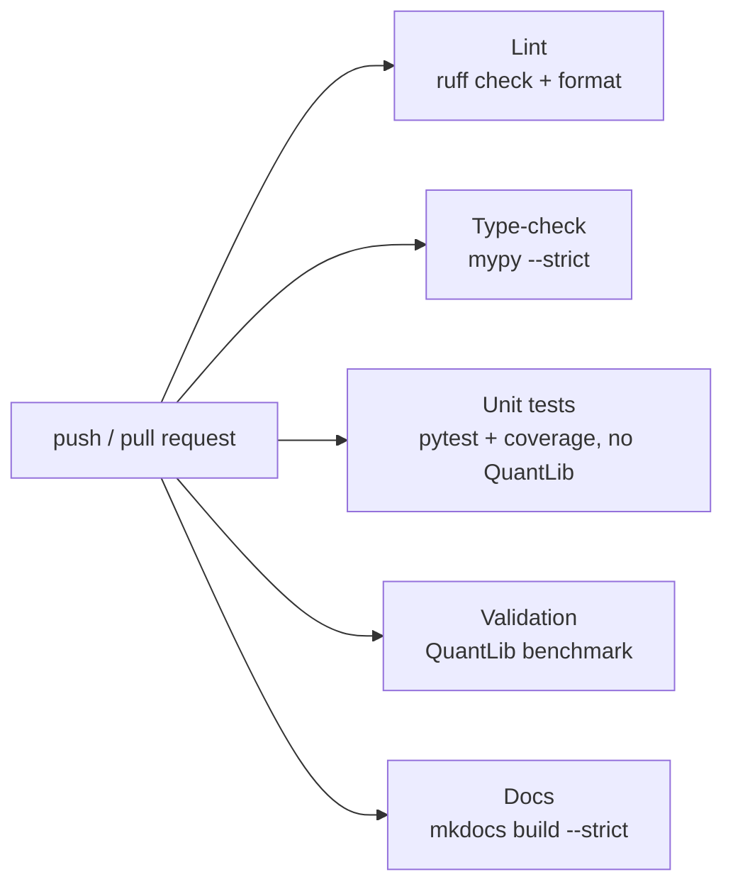

# Development

## Tooling

| Tool | Role | Configuration |
|---|---|---|
| uv | Environments, lock file (`uv.lock` is committed) | Groups: `dev`, `validation` (QuantLib), `docs` (MkDocs) |
| ruff | Lint and format | Broad rule set (pyflakes, bugbear, pylint, numpy, docstrings Google style, annotations, naive datetimes, relative imports banned) |
| mypy | `--strict` on `src`, `tests`, `validation`, `examples` | `pyproject.toml` |
| pytest + hypothesis | Unit and property-based tests | `--strict-markers`, warnings are errors, coverage gate 90% on `pricer` |
| pre-commit | ruff check, ruff format, mypy on each commit | `.pre-commit-config.yaml` |
| MkDocs Material | This site | `mkdocs.yml` |

```bash
uv sync                                     # dev + validation
uv run pytest --cov
uv run pytest validation
uv run mypy
uv run ruff check . && uv run ruff format --check .
uv run --group docs mkdocs serve
```

!!! warning "ruff formats Markdown too"
    Recent ruff versions also format the Python code blocks inside `.md` files (README,
    this site). Run `uv run ruff format --check .` as the **last** step after editing docs.

## Continuous integration



All five jobs run in parallel on every pull request and on `main`. The docs job fails on
any broken link or missing page (`--strict`).

## Coding rules

The full list is in `CLAUDE.md`; the ones that shape the code most:

- **Python only.** No C/C++ extensions. Performance comes from NumPy vectorisation, Numba
  and multiprocessing, always measured with a benchmark.
- **Separation of concerns.** Instruments hold contract terms; models hold dynamics;
  engines compute. Never branch on instrument type inside an engine.
- **Immutability.** Market data, instruments, results and engines are frozen dataclasses.
  No module-level mutable state.
- **Explicit conventions.** Dates and day counts are explicit; the public API never takes a
  raw float year fraction where a date is meant.
- **Randomness** (phase 2) always comes from an explicitly passed, seeded
  `numpy.random.Generator`.
- **Tests with every formula**: a closed form or QuantLib benchmark, plus at least one
  arbitrage or sanity property. Tolerances are explicit and justified in a comment.
- **English** in code, comments, docs and commit messages; Conventional Commits; every new
  dependency justified in the commit or PR.
- **ADRs** for significant decisions, in `docs/adr/`.

## Writing documentation

- Pages live in `docs/`; add new ones to the `nav` in `mkdocs.yml`.
- Diagrams are Mermaid fenced blocks: GitHub and MkDocs both render them.
- Maths uses `$...$` and `$$...$$` (MathJax on the site, native on GitHub).
- Each finance page follows the same outline: product, formulas as implemented,
  hypotheses and limits, validation.
- Runnable examples go in `examples/`; `tests/test_examples.py` executes them, so the
  outputs quoted in the docs cannot silently drift. Update the quoted output when a
  change moves a number.
