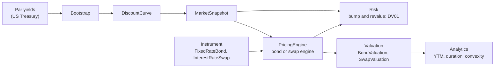

# Pricing & Risk Engine

A Python pricing and risk library, with a distributed, real-time risk service built on top
of it. The library is written the way a bank quant library is: instruments, models and
engines are separate; market data is immutable; every formula is validated against an
independent implementation.

!!! info "Status: phase 2 (options) in progress"
    Phase 1: dates and day counts, immutable market snapshot, yield-curve bootstrap from
    US Treasury par yields, fixed-rate bonds (pricing, yield, durations, convexity,
    z-spread, curve DV01), vanilla interest rate swaps on separate forecast and discount
    curves. Phase 2 so far: European options under Black-Scholes, analytic and bump-and-revalue
    Greeks, implied volatility, American options on a CRR binomial tree, Monte Carlo with
    antithetic and control variates.
    Everything is benchmarked against QuantLib. See the [roadmap](roadmap.md).

## What is in the box

| Area | Content | Read |
|---|---|---|
| Market data | Day counts, schedules, discount curves, par-yield bootstrap, `MarketSnapshot` | [Rates](finance/rates.md), [Yield curve](finance/yield-curve.md) |
| Instruments | `FixedRateBond`, `InterestRateSwap`, `EuropeanOption`, `AmericanOption` (contract terms, cash flows, payoffs) | [Fixed-rate bond](finance/fixed-rate-bond.md), [Swap](finance/interest-rate-swap.md), [Options](finance/black-scholes.md), [American](finance/american-options.md) |
| Models | `BlackScholesModel`: which snapshot curves play $r$ and $q$ | [ADR 0002](adr/0002-option-model-binding.md) |
| Engines | `DiscountingBondEngine`, `DiscountingSwapEngine` (two curves), `AnalyticEuropeanEngine` (Black-Scholes and Greeks), `BinomialTreeEngine` (CRR, European and American), `MonteCarloEuropeanEngine` | [Data flow](architecture/data-flow.md) |
| Analytics and risk | YTM, durations, convexity, z-spread, yield and curve DV01; option Greeks by bump, implied volatility | [Bond analytics](finance/bond-analytics.md), [Option risk](finance/option-risk.md) |
| Validation | 648 validation cases (QuantLib and statistical), closed forms, property-based tests | [Validation](validation.md) |

## How this documentation is organised

- **[Getting started](getting-started.md)**: install, run the checks, price a first bond.
- **[Reading guide](reading-guide.md)**: which source files to read, in which order, and
  what to look for in each. Start here to understand the code base.
- **Architecture**: the [module layers](architecture/index.md), the
  [data flow](architecture/data-flow.md) from market quotes to risk numbers, the
  [class model](architecture/class-model.md), and
  [how to extend](architecture/extending.md) the library with a new instrument.
- **Finance**: the functional side. Each page states the financial meaning, the formulas
  as implemented, the conventions and the known limits of the model.
- **[Validation](validation.md)**: how every number is checked, and with which tolerance.
- **[Development](development.md)**: tooling, CI, coding rules.
- **Decisions**: architecture decision records (ADR).

