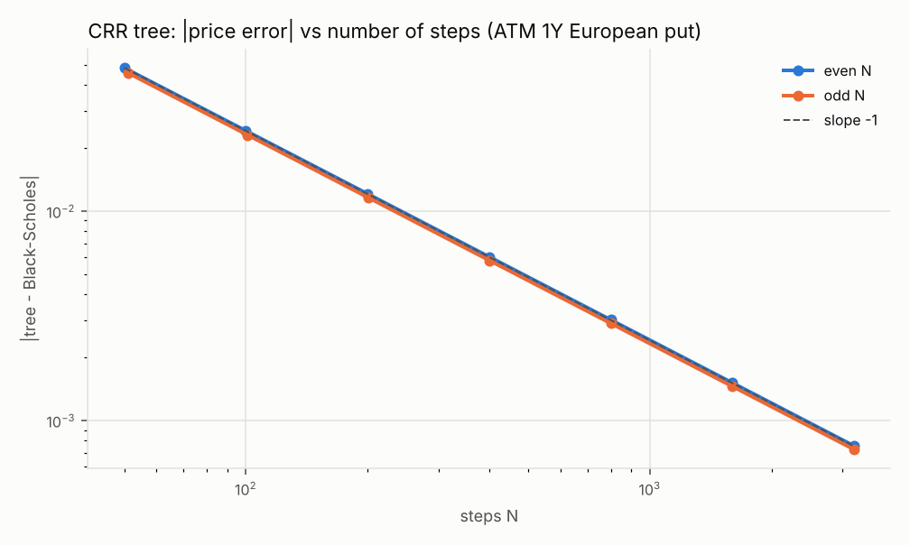
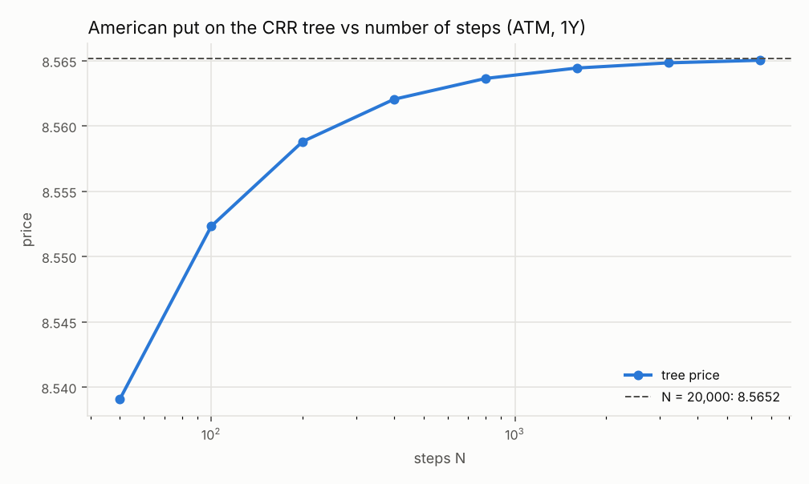
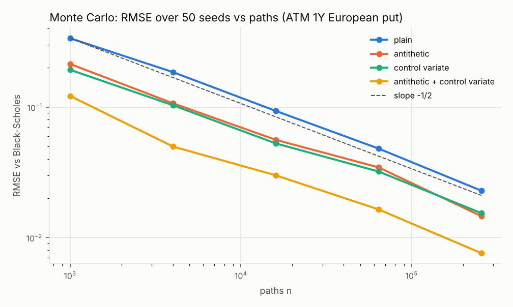

# Model Validation Report

!!! note "Generated file"
    Produced by `uv run python -m validation.report`; do not edit by hand. Every
    number is recomputed from the code (fixed grids and seeds, deterministic).

## Scope and methodology

Models under validation: the Black-Scholes model of an equity underlying and its
three numerical methods (closed form with analytic Greeks, Cox-Ross-Rubinstein
binomial tree for European and American exercise, Monte Carlo with antithetic and
control variates), plus the implied-volatility solver. The rates models of phase 1
(curve bootstrap, bonds, swaps) are validated by the same approach; their QuantLib
results are in [Validation](../validation.md).

Each method is checked three ways:

1. **Independent implementation**: QuantLib, configured with the same conventions
   (ACT/365F everywhere, null calendar, flat or bootstrapped curves), on grids that
   cover moneyness, maturity, rates (including negative), dividends and volatility.
2. **Convergence**: numerical methods must converge to the closed form at their
   theoretical rate (tree: $O(1/N)$; Monte Carlo: $O(1/\sqrt{n})$).
3. **Statistical calibration** (Monte Carlo): the reported standard errors must be
   right, i.e. the 95% confidence intervals must contain the true price 95% of the time.

Arbitrage and sanity properties (parity, bounds, monotonicity, the Black-Scholes PDE)
are enforced by the unit tests and listed on the [Validation](../validation.md) page.

## Summary

- QuantLib benchmarks: **13 of 13** quantities within tolerance.
- CRR tree convergence order: **-0.999** (theory: -1).
- Monte Carlo standard error order: **-0.500** (theory: -1/2).
- Monte Carlo 95% interval coverage: **93.2% to 95.5%** over 24 cases x 400 seeds.

## Benchmarks against QuantLib

| Comparison | Quantity | Cases | Worst observed | Tolerance | Measure |
|---|---|---:|---:|---:|---|
| Black-Scholes vs QuantLib analytic | npv | 162 | 1.3e-14 | 1.0e-10 | max \|ours - QL\| / max(\|QL\|, 1) |
| Black-Scholes vs QuantLib analytic | delta | 162 | 4.3e-15 | 1.0e-10 | max \|ours - QL\| / max(\|QL\|, 1) |
| Black-Scholes vs QuantLib analytic | gamma | 162 | 2.2e-16 | 1.0e-10 | max \|ours - QL\| / max(\|QL\|, 1) |
| Black-Scholes vs QuantLib analytic | vega | 162 | 1.1e-14 | 1.0e-10 | max \|ours - QL\| / max(\|QL\|, 1) |
| Black-Scholes vs QuantLib analytic | theta | 162 | 1.1e-13 | 1.0e-10 | max \|ours - QL\| / max(\|QL\|, 1) |
| Black-Scholes vs QuantLib analytic | rho | 162 | 1.1e-14 | 1.0e-10 | max \|ours - QL\| / max(\|QL\|, 1) |
| Black-Scholes vs QuantLib analytic | dividend_rho | 162 | 1.2e-14 | 1.0e-10 | max \|ours - QL\| / max(\|QL\|, 1) |
| Implied vol from QuantLib prices | volatility | 82 | 3.1e-12 | 1.0e-10 | max \|sigma_implied - sigma_true\| |
| CRR tree vs QuantLib CRR, N = 1000 | npv | 288 | 1.6e-03 | 3.0e-03 | max abs |
| CRR tree vs QuantLib CRR, N = 1000 | delta | 288 | 2.3e-05 | 1.0e-04 | max abs |
| CRR tree vs QuantLib CRR, N = 1000 | gamma | 288 | 9.6e-04 | 2.0e-03 | max relative |
| CRR tree vs QuantLib CRR, N = 1000 | theta (not exercised) | 288 | 1.3e-03 | 5.0e-03 | max abs |
| American tree N = 2000 vs QuantLib PDE 800 x 800 | npv | 24 | 4.5e-03 | 5.0e-03 | max abs |

The closed form and the implied volatility agree with QuantLib to rounding. The
tree gap is *expected*: QuantLib's CRR uses a first-order expansion of our up
probability, so the two trees differ by $O(1/N)$; their agreement with the closed
form (below) and with a PDE solver is what validates the tree. Where an American
option is exercised immediately, QuantLib's tree theta (derived from the PDE) is
not comparable and is excluded; see
[American options](../finance/american-options.md#greeks-from-the-tree).

## Monte Carlo error model

For each setting: 6 cases (strikes 80, 100, 130 x call, put), 400 seeds x 2,000
paths each, against QuantLib's closed form. $z = (\hat V - V)/\text{s.e.}$ should be
standard normal.

| Setting | 95% coverage (min - max) | max abs mean(z) | var(z) (min - max) |
|---|---:|---:|---:|
| plain | 93.5% - 95.2% | 0.141 | 0.96 - 1.07 |
| control variate | 94.5% - 95.2% | 0.131 | 1.02 - 1.06 |
| antithetic | 93.2% - 95.0% | 0.123 | 1.01 - 1.03 |
| antithetic + control variate | 94.0% - 95.5% | 0.115 | 1.04 - 1.09 |

Accepted bands (3 sampling standard deviations for 400 seeds): coverage 91.7% to
98.3%, mean within 0.2, variance 0.75 to 1.3.

## Convergence of the binomial tree

Reference: one-year at-the-money European put, $S = K = 100$, $r = 5\%$, $q = 2\%$, $\sigma = 25\%$; Black-Scholes price 8.226837.

| N (even) | error | N (odd) | error | error x N (even) |
|---:|---:|---:|---:|---:|
| 50 | -4.82e-02 | 51 | +4.57e-02 | -2.412 |
| 100 | -2.42e-02 | 101 | +2.30e-02 | -2.415 |
| 200 | -1.21e-02 | 201 | +1.16e-02 | -2.417 |
| 400 | -6.04e-03 | 401 | +5.80e-03 | -2.418 |
| 800 | -3.02e-03 | 801 | +2.90e-03 | -2.418 |
| 1600 | -1.51e-03 | 1601 | +1.45e-03 | -2.418 |
| 3200 | -7.56e-04 | 3201 | +7.26e-04 | -2.418 |

The error is $O(1/N)$ (error x N is constant) and **changes sign with the parity of**
$N$: even trees have a node at the strike, odd trees straddle it. Averaging $N$ and
$N + 1$, or smoothing the last step with Black-Scholes, removes most of it.

### American put

| N | price | minus N = 20,000 |
|---:|---:|---:|
| 50 | 8.539077 | -2.61e-02 |
| 100 | 8.552325 | -1.28e-02 |
| 200 | 8.558810 | -6.36e-03 |
| 400 | 8.562050 | -3.12e-03 |
| 800 | 8.563644 | -1.52e-03 |
| 1600 | 8.564443 | -7.24e-04 |
| 3200 | 8.564837 | -3.30e-04 |
| 6400 | 8.565034 | -1.33e-04 |

The European price of the same put is 8.226837: the early exercise premium is about 0.3383.

## Convergence of Monte Carlo

Same European put; root mean square error over 50 seeds, and the average
reported standard error.

| Setting | n = 1,000 | n = 4,000 | n = 16,000 | n = 64,000 | n = 256,000 | RMSE order |
|---|---:|---:|---:|---:|---:|---:|
| plain | 3.4e-01 (3.6e-01) | 1.9e-01 (1.8e-01) | 9.3e-02 (9.0e-02) | 4.8e-02 (4.5e-02) | 2.3e-02 (2.2e-02) | -0.49 |
| antithetic | 2.1e-01 (2.5e-01) | 1.1e-01 (1.2e-01) | 5.6e-02 (6.2e-02) | 3.4e-02 (3.1e-02) | 1.5e-02 (1.5e-02) | -0.47 |
| control variate | 1.9e-01 (2.2e-01) | 1.0e-01 (1.1e-01) | 5.3e-02 (5.6e-02) | 3.2e-02 (2.8e-02) | 1.5e-02 (1.4e-02) | -0.45 |
| antithetic + control variate | 1.2e-01 (1.1e-01) | 5.0e-02 (5.5e-02) | 3.0e-02 (2.8e-02) | 1.6e-02 (1.4e-02) | 7.6e-03 (7.0e-03) | -0.48 |

Cells: RMSE (average reported standard error). The RMSE order is noisy with 50
seeds; the standard-error order is exact up to sampling: plain -0.500, antithetic -0.499, control variate -0.499, antithetic + control variate -0.497.

Variance reduction at n = 256,000, as a ratio of variances (equivalent path multiplier): antithetic x2.1, control variate x2.6, antithetic + control variate x10.3. The control variate gains much more deep in the money, where the payoff is almost linear in the spot (see [Monte Carlo pricing](../finance/monte-carlo.md)).

## Known limitations

- **Lognormal dynamics with deterministic rates and volatility.** No smile dynamics,
  no jumps, no stochastic rates; the engines read $\sigma(T, K)$ from a surface but
  the Greeks assume the surface does not move with the spot. Heston comes in phase 3.
- **Continuous dividend yield.** Discrete cash dividends are not modelled; this
  matters most for American calls on single stocks.
- **Tree rates are the zero rates to expiry.** Exact for European options; for
  American options under a sloped curve the exercise decision uses a flat rate.
- **CRR oscillation.** First-order convergence with parity effects; no smoothing,
  Richardson extrapolation or Leisen-Reimer tree yet.
- **Monte Carlo is European only.** American exercise by simulation (Longstaff-
  Schwartz) and path-dependent payoffs are out of scope; gamma by bump is noisy
  (no pathwise or likelihood-ratio estimators).
- **Implied volatility** is limited by vega: far from the money at low volatility
  the time value is below double precision and no volatility can be implied.
- **Theta conventions** differ between the analytic Greeks (zero rates to expiry
  fixed) and the bump (forwards realised); both are documented.

## Environment

Python 3.12.3, NumPy 2.5.4, QuantLib 1.44, matplotlib 3.11.2.
