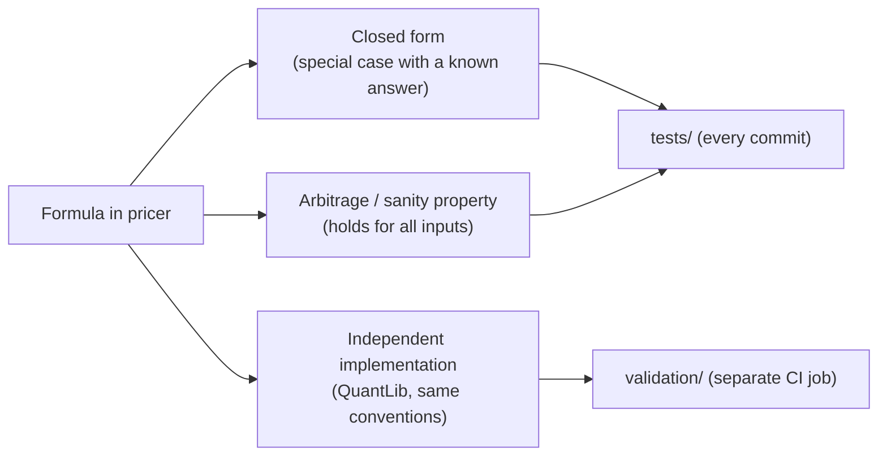

# Validation

Every formula in the library is checked in three independent ways. A number that has not
been checked against something it was not derived from is not considered done.



## The three levels

**1. Closed forms.** Special cases where the answer is known analytically.

| Area | Check |
|---|---|
| Bootstrap | Flat par yields $c$ on a 6M grid give $P(n \times 6M) = (1 + c/2)^{-n}$; a sub-6M quote is simple interest. |
| Bond | Each bootstrap par bond prices at 100 on its own curve; on a flat curve the price is a geometric sum. |
| Analytics | A single cash flow has a Macaulay duration equal to its time; zero-coupon bond yields. |
| Risk | Zero-coupon curve DV01 $= t \cdot P \cdot 10^{-4}$, up to $O((ht)^2)$. |
| Swap | Single-curve floating leg $= N(D(t_0) - D(T))$; par rate closed form; swap at its par rate is worth 0. |
| Options | Textbook example (Hull); at-the-money-forward $V = D_r F\,\mathrm{erf}\big(\sigma\sqrt{T}/(2\sqrt{2})\big)$; zero volatility gives the discounted forward intrinsic value. |

**2. Properties.** Relations that must hold for any input, several of them generated with
hypothesis (property-based testing).

- Rate conversions are exact inverses, for every compounding and frequency.
- The bootstrapped curve reprices every input quote; the result does not depend on the
  quote order; bumping one pillar does not move the curve before the previous pillar
  (locality).
- Price-yield round trip; closed-form durations and convexity match finite differences;
  the second-order expansion beats the first-order one.
- Dirty price drops by one coupon across a coupon date, clean price stays continuous.
- A cheaper bond has a higher z-spread; payer = −receiver for swaps.
- Bumping never modifies the base snapshot.
- Options: put-call parity (and its Greeks: $\Delta_C - \Delta_P = D_q$, equal gammas and
  vegas), no-arbitrage bounds, decreasing and convex in strike, the Black-Scholes PDE
  $\Theta + (r-q)S\Delta + \tfrac12\sigma^2S^2\Gamma - rV = 0$; analytic Greeks match central
  finite differences and bumps of the snapshot (spot, volatility, each curve).
- Bump-and-revalue Greeks match the analytic ones; a rolled curve keeps its forward rates;
  bump theta is the exact one-day value change on flat curves and differs from the analytic
  theta by rho times the roll-down on a sloped curve.
- Binomial tree: European put-call parity exact at any number of steps, American ≥
  max(European, payoff), American call without dividends = European call (Merton),
  American put with negative rates = European put, American value increasing in maturity.
- Implied volatility: price → vol → price round trip, call and put imply the same vol,
  prices outside the no-arbitrage bounds are rejected.

**3. QuantLib benchmark** (`validation/`). QuantLib is set up to reproduce the library's
conventions *exactly* (`NullCalendar`, `Unadjusted`, zero settlement days, backward
schedules, the same day counts), so any remaining difference is an implementation error,
not a modelling choice.

| Suite | Grid | Quantity | Tolerance | Why this tolerance |
|---|---|---|---|---|
| Yield curve | 5 shapes (normal, inverted, humped, negative, flat) × 6 reference dates | Discount factors | $10^{-11}$ | QuantLib's bootstrap solves each pillar to $10^{-12}$ |
| Bond | 6 bonds × 3 valuation dates | Clean, dirty, accrued | $10^{-10}$ | Per 100 of face: $10^{-12}$ relative, a few hundred ulps |
| | | Yield | $10^{-11}$ | Both sides solve a root; ours to $10^{-14}$, QuantLib's to its default accuracy |
| | | Durations, convexity | $10^{-9}$ relative | Evaluated at the solved yield, so they inherit its error |
| | | Z-spread (2 points below the curve price) | $10^{-9}$ | QuantLib's z-spread solver accuracy |
| Swap | 6 swaps × (single, two-curve) | NPV, leg PVs | $10^{-8} \times N$ | Well below a cent per million; QuantLib compounds daily, we telescope |
| | | Par rate | $10^{-12}$ | |
| Implied volatility | 90 cases: 5 strikes × 3 expiries × 3 vols (5%–120%) × call/put | Volatility | $10^{-10}$ + $10^{-14} V/\text{vega}$ | A price known to $\varepsilon$ fixes $\sigma$ to $\varepsilon/\text{vega}$; observed $\le 3.1 \times 10^{-12}$; 8 cases with time value at noise level check repricing |
| CRR tree (American and European) | 3 spots × 3 expiries × 2 rates × 2 dividend yields × 2 vols × call/put, both styles: 288 cases at N = 1000 | Price, delta, gamma, theta | $3 \times 10^{-3}$, $10^{-4}$, $2 \times 10^{-3}$ rel., $5 \times 10^{-3}$ | QuantLib's CRR uses a first-order expansion of our up probability: the trees differ by O(1/N); observed price gap $\le 1.6 \times 10^{-3}$. Theta differs by definition where the option is exercised today (see the American options page) |
| American option vs PDE | 24 cases, tree N = 2000 vs `FdBlackScholesVanillaEngine` 800 × 800 | Price | $5 \times 10^{-3}$ | Independent numerical method, both errors ~$10^{-3}$ |
| European option (Black-Scholes) | 144 flat markets (3 spots × 3 expiries × 2 rates incl. negative × 2 dividend yields × 2 vols × call/put) + 18 on a bootstrapped curve | Price, delta, gamma, vega, theta, rho, dividend rho | $10^{-10}$ relative, $10^{-12}$ absolute | Same closed form on both sides; observed $\le 1.1 \times 10^{-13}$ |

The reference dates are chosen to break date generation: 29 and 31 August, 29 February,
31 January, mid-month, the last business day of a year.

## What the benchmark found

The QuantLib comparison found a **1 bp bug** that every closed-form test had missed. For a
1Y bond issued on 29 August 2026, stepping back 6M from the maturity gives 28 February
(clamped), and the code derived the ICMA reference period from 28 February, which turned
the first coupon into a false stub. The first period is regular exactly when the date
generated from maturity lands on the issue date; `Schedule.periods` now tests that, and a
regression test pins it.

This is the argument for an independent implementation: closed forms test the formula,
the benchmark tests the conventions.

## Running it

```bash
uv run pytest --cov          # tests/ with the 90% coverage gate (no QuantLib needed)
uv run pytest validation     # QuantLib suite
```

In CI, unit tests run without QuantLib (`uv sync --no-group validation`), and the
benchmark runs as its own job, so a QuantLib installation problem can never hide a unit
test failure.

## Planned

A generated **Model Validation Report** (phase 2): methodology, error tables, convergence
plots for Monte Carlo and trees, known limitations.
